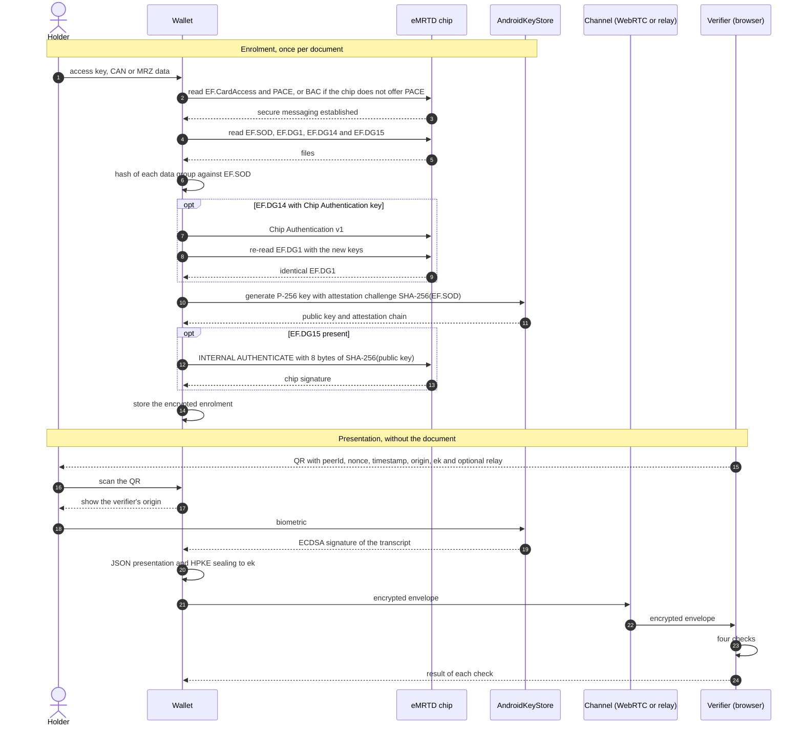

# eudi-icao-android-wallet

[Versión en español](README.md)

Native Android application that reads over NFC the ICAO 9303 chip of a Spanish DNIe or of a passport, binds the
document to a P-256 key stored in AndroidKeyStore and presents it to a verifier that runs in a browser. It is the
mobile half of a research experiment. The other half, with the trust anchors and all cryptographic verification, is
in the `eudi-icao-web-verifier` repository.

This is research code. It builds, its JVM tests pass and it has been run end to end with a Spanish DNIe and a
Spanish passport on a single phone. The [Verification status](#verification-status) section details what has been
checked and what has not.

## Problem statement

The case is specific: proving to a website possession of a State-issued identity document. The ICAO 9303 chip that
the DNIe and the passport already carry contains State-signed data. EF.SOD is a CMS SignedData signed by a Document
Signer issued by the CSCA SPAIN of the Dirección General de la Policía, and anyone can verify it with a public
certificate. No issuer server is involved at verification time and no new credential has to be requested from a
provider.

In the eIDAS 2.0 model (Regulation (EU) 2024/1183, EUDI Wallet) verifying a presentation does not contact the issuer
in real time either. The dependency lies elsewhere: the PID is issued by a designated provider to a certified wallet
(OpenID4VCI), attestations are short-lived and reissued in batches to limit correlation, the wallet needs an
attestation from its provider, relying parties must register and obtain access certificates, and revocation is
published in status lists. These are new points of control and of availability.

The physical document already issued solves one part of the problem, State-signed attributes, without that
infrastructure. It does not solve others: selective disclosure, unlinkability, binding to the holder and revocation.
This repository explores the first part and records where it falls short.

## Finding on the DNIe

The initial design had the chip sign, with Active Authentication (INTERNAL AUTHENTICATE), a challenge derived from
the phone's key. That design cannot be executed on a DNIe.

The DNIe 3.0/4.x and the Spanish passport 4.x do not expose EF.DG15 and do not implement Active Authentication. They
only offer Chip Authentication v1 through EF.DG14. The sources are the jmulticard library of the Government of Spain
(class `Dnie3`: "Este MRTD no tiene DG15") and the FNMT-RCM Common Criteria security targets for "Tarjeta DNIe
4.0/4.01/4.02" and "Pasaporte electrónico 4.0/4.01", published by the CCN Certification Body. The sample EF.SOD of
the DNIe 3.0 lists data groups 1, 2, 3, 7, 11, 13 and 14. Reading a valid DNIe and a valid passport with this
application confirms it: neither EF.SOD lists EF.DG15.

Chip Authentication is a key agreement. It proves the authenticity of the chip to the terminal that runs it, but it
leaves no proof that a third party can verify. This is the origin of the two binding modes implemented by this
application, described in [Chip-to-device binding](#chip-to-device-binding).

The full analysis of the verification side (CSCA anchors, Passive Authentication, attestation validation, policy) is
in `eudi-icao-web-verifier`.

## Application flows

The application has two flows. Enrolment needs the document and is done once. Presentation uses what was stored at
enrolment and the device key; the document is no longer involved.

The interface is available in Spanish and English and follows the system language; on Android 13 or later it can be
chosen per application in the settings. Technical identifiers (EF.SOD, PACE, OID, algorithm names) and the names of
the log steps are not translated.

The default path is simple: add the document, scan the code, confirm with the fingerprint and see the result. The
cryptographic detail stays in the technical view, reachable from the main screen. Personal data is hidden by
default: the document number is shown with only its last three characters, the confirmation screen lists which
categories of data are sent without showing their values, and in the technical view the MRZ and its fields have to
be revealed with an explicit control.

### Enrolment

It is run by `DniEPassportReader` on top of JMRTD 0.8.9 and SCUBA. Any step that cannot be completed aborts the
enrolment; there are no degraded paths. The failure is classified (wrong access key, lost contact, NFC turned off,
no strong biometric and others) and shown with a message in the interface language; the technical detail remains
available separately.

1. The holder chooses the document type and holds the document against the phone. For the DNIe they enter the CAN
   (6 digits printed on the front). For the passport, which usually has no printed CAN, they enter the MRZ data:
   document number, date of birth and date of expiry, written as DD/MM/YYYY and converted to the MRZ format by the
   application. NFC reader mode (NFC-A and NFC-B, without NDEF check) is only armed while the enrolment screen is
   waiting or reading.
2. EF.CardAccess is read and PACE is run with that key. Among the PACEInfo offered, ECDH, AES and Generic Mapping
   are preferred. If the key is MRZ data and the chip does not offer PACE (there is no EF.CardAccess or it contains
   no PACEInfo), BAC is used with the same key. With a CAN there is no alternative: a document without PACE is
   rejected.
3. The eMRTD application is selected and EF.SOD, EF.DG1 and, if the SOD lists them, EF.DG14 and EF.DG15 are read.
   No other data group is read; the photograph (EF.DG2) does not leave the chip.
4. Integrity check: the hash of each file read is compared with its entry in the SOD. The algorithm is taken from
   `LDSSecurityObject.hashAlgorithm`; SHA-256 is not assumed (the sample SOD of the DNIe 3.0 uses SHA-1).
5. If EF.DG14 contains a Chip Authentication public key, Chip Authentication v1 is run against it. When the chip
   offers several combinations, AES is chosen over 3DES and the longest key is chosen. EF.DG1 is then re-read with
   the new secure messaging keys, without cache, and compared byte by byte with the first read. If the re-read fails
   or differs, the enrolment is aborted.
6. Only then is the device key generated in AndroidKeyStore: EC P-256, used exclusively for signing with SHA-256,
   class 3 biometric required for every operation, and invalidated if a new biometric is enrolled. It is requested
   in StrongBox when the device declares it and, if that is not available, in the default keystore. The attestation
   challenge is `SHA-256(EF.SOD)`.
7. If the document has EF.DG15, INTERNAL AUTHENTICATE is sent with `RND.IFD` equal to the first 8 bytes of
   `SHA-256(SubjectPublicKeyInfo of the device key)` and the chip's response is stored.
8. The result is stored encrypted. The binding mode is fixed: `aa` if Active Authentication took place,
   `ca-attestation` otherwise. In `ca-attestation`, if AndroidKeyStore does not return an attestation chain, the
   enrolment fails.

A document that offers neither EF.DG15 nor a Chip Authentication key in EF.DG14 is rejected. The complete read has a
limit of 60 seconds.

The wallet does not perform Passive Authentication: it includes no CSCA anchors. The hash comparison of step 4 is a
consistency check against an SOD whose signature only the verifier validates.

Only one document is enrolled at a time. A new enrolment deletes the previous one at the moment the new key is
generated; if the read fails after that point, no enrolment remains.

### Presentation

1. The verifier shows a QR code with the session descriptor. The wallet reads it with the camera (CameraX and ML
   Kit, QR codes only).
2. The descriptor is validated before anything is shown: version 1, 32-byte `nonce`, `ek` as an uncompressed P-256
   point on the curve, `timestamp` within 5 minutes of the phone's clock, `origin` in the form of an http or https
   origin without path, and `relay`, if present, without query, fragment or trailing slash.
3. The confirmation screen shows the verifier's origin in large type, the categories of data to be sent and a warning
   when the origin is not `https`. The transport, the session data and the demonstration option are under "Advanced
   options", collapsed by default.
4. On confirmation, the wallet builds the transcript `"eudi-icao-auth-v1\n" + nonce + "\n" + origin` and requests the
   signature from AndroidKeyStore. The BiometricPrompt repeats the origin as subtitle. The signature is ECDSA P-256
   with SHA-256, in DER.
5. The presentation is assembled in JSON with the exact bytes read from the chip (EF.DG1, EF.DG14, EF.DG15, EF.SOD),
   the device public key, the binding mode, the INTERNAL AUTHENTICATE response in `aa` mode, the attestation chain if
   it exists, and the transcript signature.
6. The presentation is encrypted with HPKE (RFC 9180, base mode, DHKEM P-256, HKDF-SHA256, AES-128-GCM) to the
   verifier's ephemeral key `ek`, with `info = "eudi-icao-presentation-v1"` and the `nonce` as AAD.
7. The encrypted envelope is delivered over the chosen transport and the wallet waits for the result.
8. The screen shows the verifier's verdict and the status of its four checks: Passive Authentication, Data
   Integrity, Chip-to-Device Binding and Live Nonce Proof.

The age of the descriptor is checked again before and after signing. The session is considered consumed as soon as
delivery starts, because the verifier consumes it with the first presentation it receives, valid or not.

Among the advanced options there is a demonstration option that sends an altered EF.DG1: it changes the first
character of the document number before sending. The hash no longer matches the SOD and the verifier's Data
Integrity check must fail.

### Sequence diagram



### Transport

The main channel is a WebRTC DataChannel opened with PeerJS. To speak exactly the same protocol as the browser, the
wallet loads the browser build of peerjs 1.5.5, included in the assets, in an off-screen WebView. That WebView only
receives the already encrypted envelope, split into frames of at most 8000 characters. The wallet always uses the
PeerJS cloud signalling server (`0.peerjs.com`) and the library's default ICE servers.

The HTTP relay is optional and only available if the descriptor carries `relay`. The wallet PUTs the envelope (at
most 262144 bytes) into the session mailbox and polls `{relay}/result?wait=25` until it receives the result, with at
least one second between polls and a total limit of 60 seconds. An `http://` relay only works in the debug build,
which is the only one that allows cleartext traffic.

The presentation leaves the wallet already sealed with HPKE. The PeerJS signalling server and the relay only see
ciphertext.

## Chip-to-device binding

The nonce signature in each session is made by the device key, not by the chip. What gives that signature its value
is the proof that the key was bound to a genuine chip during enrolment. There are two ways of providing that proof.

### `aa` mode

Used when the document exposes EF.DG15. The chip signs with INTERNAL AUTHENTICATE the first 8 bytes of
`SHA-256(device public key)`, and the verifier checks that signature with the EF.DG15 key, whose hash is in the
SOD. The proof is cryptographic and transferable, but the binding is 64 bits, which is the maximum allowed by the
Active Authentication challenge.

The wallet does not verify the chip's signature; it only checks that the response has the length corresponding to
the EF.DG15 key. Verification is the verifier's task.

### `ca-attestation` mode (DNIe profile)

Used when the document has EF.DG14 with a Chip Authentication key and does not have EF.DG15. Since Chip
Authentication leaves no transferable proof, the proof the verifier receives is the attestation of the device key
(Android Key Attestation), whose challenge is `SHA-256(EF.SOD)`.

The trust argument has three links and they should be kept apart.

1. Passive Authentication and Data Integrity, in the verifier. The presented SOD is signed by a Document Signer
   under a pinned CSCA, and the hashes of EF.DG1 and EF.DG14 match it. Therefore the Chip Authentication public key
   in EF.DG14 is the one the State put in that document.
2. The attestation, in the verifier. The certificate chain reaches a pinned Google attestation root. The leaf
   certificate attests the same public key that signs the nonce, generated inside secure hardware (TEE or
   StrongBox) as an EC P-256 signing key. The attested challenge is the hash of the presented SOD. With the default
   policy, the device booted in verified state with the bootloader locked. The application that requested the key
   has the package name and the signing certificate fingerprint pinned in the verifier's policy.
3. The behaviour of the attested build, which nobody verifies at run time. In the code of this repository, the only
   call that generates the device key is in the `bindDeviceKey` callback of `WalletViewModel`, and
   `DniEPassportReader` only invokes it after access control (PACE or BAC) has succeeded, the hashes of EF.DG1 and
   EF.DG14 match the SOD, Chip Authentication has completed against the EF.DG14 key and EF.DG1 has been re-read
   unchanged under the keys derived from that agreement.

If the three links hold, the existence of the attestation implies that a chip holding the private key corresponding
to EF.DG14 answered that phone over NFC and that whoever operated it knew the CAN or the MRZ data. There is no
distance bounding: a chip reached through an NFC relay meets the same condition.

What the attestation proves on its own: that a hardware key was generated by that specific build with that
challenge. What it does not prove: the presence of the chip and the success of Chip Authentication are not signed by
the document. They rest on the integrity of the attested build, that is, on link 3.

Conditions on which link 3 depends:

- EF.SOD is not secret. Anyone who has read the chip once has it, and every verifier receives it in every
  presentation together with EF.DG1 and EF.DG14. Computing its hash and requesting an attestation with that
  challenge is trivial. The only thing separating that third party from a valid enrolment is that the attestation
  would reveal a different application or a different boot state. Without pinning the application identity and
  requiring verified boot, the attestation says nothing about the document.
- The wallet signing key must only sign non-debuggable builds of the audited code. The `attestationApplicationId`
  field contains the package, the version and the certificate fingerprint; it does not distinguish a debuggable
  build. In a debug build, whoever has the phone with USB debugging authorised can run code inside the process and
  request a key with any challenge they want. In addition, the Android debug key is local to each machine and its
  password is public. Pinning the fingerprint of a debug build serves to rehearse the flow, not to support this
  argument.
- The Google attestation PKI and the manufacturer's TEE must be trustworthy. A leaked attestation key or a
  compromised TEE make it possible to forge attestations.
- The wallet code must have no flaws that allow reaching key generation with a chosen SOD.

This mode introduces the Google attestation PKI and the wallet signing key as trust anchors, in addition to the
CSCA. It is a third-party dependency that the initial approach sought to avoid.

### What neither mode covers

The presence of the chip is established at enrolment, not at each presentation. A presentation proves control, with
biometrics, of the key that was bound to the chip at the time. The biometric is the phone's: it shows that someone
enrolled on that device is signing, not that they are the holder of the document. The wallet does not compare any
trait of the person with the document.

## Protocol

Summary of what the wallet consumes and emits. The field names are those of the code in `protocol/`.

Session descriptor (QR content, from the verifier to the wallet):

```json
{"v":1,"peerId":"...","nonce":"<base64url, 32 bytes>","timestamp":1731600000000,
 "origin":"https://host","ek":"<base64url, punto P-256 de 65 bytes>","relay":"<opcional>"}
```

Encrypted envelope (from the wallet to the verifier):

```json
{"v":1,"type":"sealed","enc":"<base64, clave encapsulada de 65 bytes>","ct":"<base64, texto cifrado y tag>"}
```

Presentation (plaintext inside the envelope):

| Field | Content |
| --- | --- |
| `v`, `nonce`, `origin` | version 1 and the descriptor values, unmodified |
| `dg1`, `dg14`, `dg15`, `sod` | exact bytes read from the chip, in base64; `dg14` and `dg15` only if they exist |
| `devicePublicKey` | DER SubjectPublicKeyInfo of the device P-256 key |
| `binding` | `aa` or `ca-attestation` |
| `chipSignatureOverDeviceKey` | INTERNAL AUTHENTICATE response; only in `aa` mode |
| `keyAttestation` | X.509 attestation chain, leaf first; mandatory in `ca-attestation` |
| `deviceSignatureOverNonce` | DER ECDSA signature over the transcript |
| `device` | model, Android version and key storage type; informative, not verifiable |

Derived values: `aaChallenge` is the first 8 bytes of `SHA-256(devicePublicKey)`; `attestationChallenge` is
`SHA-256(sod)`; the transcript is the UTF-8 text `"eudi-icao-auth-v1\n" + nonce + "\n" + origin`.

PeerJS channel frames: the envelope travels as `{"t":"part","i":<índice>,"n":<total>,"d":"<fragmento>"}` and the
result comes back as `{"t":"result","ok":<bool>,"checks":[{"id":"...","status":"pass|fail|skipped"}]}`.

## On-device data and network connections

- The enrolment is stored in a single file under `noBackupFilesDir`, encrypted with AES-256-GCM with an
  AndroidKeyStore key. It contains EF.CardAccess, EF.SOD, EF.DG1, EF.DG14, EF.DG15, the device public key, the
  Active Authentication response, the attestation chain and the read step log. The application declares
  `allowBackup="false"`.
- The access key (CAN or MRZ data) is used for PACE or BAC and is not stored. It remains in memory until the
  enrolment completes successfully.
- The device private key does not leave AndroidKeyStore. If the system invalidates it (enrolment of a new biometric
  or removal of the screen lock), the next presentation attempt deletes the enrolment and asks for it to be
  repeated.
- The application does not log personal data, file contents, the access key or key material. The `org.jmrtd` and
  `net.sf.scuba` loggers, which dump APDUs, are silenced.
- In non-debuggable builds the window carries `FLAG_SECURE`: the MRZ and personal data do not appear in screenshots
  or in the recent apps view. Screenshots are allowed by the debug build and by a build compiled with
  `-PwalletAllowScreenCapture=true`, which is meant for documenting the interface and not for distribution.
- Outgoing connections: the PeerJS signalling server and its ICE servers (a Google STUN server and the PeerJS TURN
  servers), or the relay indicated in the descriptor. In addition, the ML Kit library that decodes the QR brings
  with it the Google telemetry component (`datatransport`) and may send usage metrics to Google when the scanner is
  used. Decoding is done on the device with the model included in the APK.

The technical view shows everything stored: MRZ with its check digits (hidden by default), hash of each file and its
comparison with the SOD, summary of the SOD and of the Document Signer, the access control used (PACE or BAC and with
which key), the Chip Authentication parameters, the decoded attestation chain (security level, challenge, boot
state, `attestationApplicationId`) with the date until which it is valid, the enrolment step log and the build
identity. With no document enrolled, the technical view shows the device status and the build identity. The main
screen indicates until which date the attestation chain is valid and warns when it has expired.

## Code structure

A single module, `:app`. Sources in `app/src/main/kotlin/dev/eudisovereign/icaowallet`, JVM tests in
`app/src/test/kotlin/dev/eudisovereign/icaowallet`.

| Package | Content |
| --- | --- |
| (root) | `MainActivity`: hosts Compose, arms NFC reader mode during enrolment, `FLAG_SECURE` |
| `crypto` | `Codec` (hex, base64, hashes), `Hpke` (RFC 9180 on BouncyCastle), `KeystoreManager` (device key, attestation, signing with BiometricPrompt) |
| `data` | `Enrollment` (enrolled document, serialisable) and `EnrollmentStore` (AES-256-GCM file) |
| `nfc` | `DniEPassportReader` (enrolment sequence on JMRTD), `AccessKey` (CAN or MRZ data), `DocumentSecurity` (SOD, Chip Authentication parameters, Active Authentication algorithms), `NfcReaderMode` |
| `protocol` | `SessionDescriptor`, `Presentation`, `Derivation`, `SealedEnvelope`, `PartFrame`, `ResultFrame` |
| `report` | `DocumentReport`, `Attestation` (KeyDescription decoding), `Mrz`, `BuildIdentity`: technical view data |
| `transport` | `Transport`, `PeerJsTransport` (peerjs in WebView), `RelayTransport` (OkHttp) |
| `ui` | `WalletViewModel` (sole owner of state), state types and Compose screens: Home, Enrolment, Scanner, Presentation, Technical. `Problem` (failure categories), `Texts` (mapping of categories to text resources), `DateInput`, `Masking`, `ReadProgress` |

The texts are in `app/src/main/res/values/strings.xml` (English) and `values-es/strings.xml` (Spanish).

`app/src/main/assets/peerjs` contains the browser build of peerjs 1.5.5 and its licence. The versions of all
dependencies are in `gradle/libs.versions.toml`. The main ones: JMRTD 0.8.9, scuba-sc-android 0.0.27,
BouncyCastle 1.86, androidx.biometric 1.1.0, CameraX 1.6.2, ML Kit barcode-scanning 17.3.0, OkHttp 5.5.1.

## Building and installation

The commands are for Windows PowerShell, from the repository root.

### Published APK

The repository Releases include the signed `release` APK, which is the build pinned by the policy of the verifier
published at <https://emrtd-verifier.web.app>. The SHA-256 fingerprint of its signing certificate is
`7f39f1b663b09c1485acb934f340a9c772bb90e90c2d1a6bfb4dacf6ee5d02a1`; it can be checked with `apksigner` as described
below. It requires Android 8.0 or later, NFC and an enrolled class 3 biometric. Since it does not come from a store,
Android asks to allow installation from the source used and may show a Play Protect warning.

An APK built from this code carries a different signature, and the published verifier rejects it until its
fingerprint is pinned in the policy.

### Requirements

- JDK 17 or later. The build has been done with Temurin 21.
- Android SDK with platform 37 (`platforms;android-37.0`), build-tools 37.0.0 and platform-tools.
- The wrapper downloads Gradle 9.5.1. AGP 9.3.3 compiles Kotlin 2.4.21 by itself; the
  `org.jetbrains.kotlin.android` plugin is not applied.
- To run the application: a phone with Android 8.0 (API 26) or later, NFC, an enrolled class 3 biometric and a
  camera. For `ca-attestation` mode the phone must have hardware key attestation, verified boot and a locked
  bootloader. An emulator will not do.

The SDK location is given with the `ANDROID_HOME` variable or with `sdk.dir` in `local.properties`, which git
ignores.

```powershell
$env:JAVA_HOME = 'C:\ruta\al\jdk'
$env:ANDROID_HOME = 'C:\ruta\al\android-sdk'
```

### Smart App Control and aapt2

On Windows with Smart App Control, unsigned native binaries do not run. The `aapt2.exe` that AGP downloads from
Maven is not signed, so Smart App Control blocks it. The `aapt2.exe` in the SDK build-tools 37.0.0 does carry an
Authenticode signature. AGP is told to use that one with the `android.aapt2FromMavenOverride` property in the user's
`gradle.properties`, not in the repository's, because it is an absolute path specific to each machine:

```powershell
$gradleHome = if ($env:GRADLE_USER_HOME) { $env:GRADLE_USER_HOME } else { "$env:USERPROFILE\.gradle" }
New-Item -ItemType Directory -Force -Path $gradleHome | Out-Null
$aapt2 = "$env:ANDROID_HOME\build-tools\37.0.0\aapt2.exe"
Add-Content -LiteralPath "$gradleHome\gradle.properties" -Value ('android.aapt2FromMavenOverride=' + $aapt2.Replace('\', '\\'))
```

The resulting line has the backslashes doubled, as the properties format requires:

```properties
android.aapt2FromMavenOverride=C:\\ruta\\al\\android-sdk\\build-tools\\37.0.0\\aapt2.exe
```

AGP warns on every build that the option is experimental. Without Smart App Control this step is not needed.

### Build, test and install

```powershell
.\gradlew.bat assembleDebug
.\gradlew.bat testDebugUnitTest
& "$env:ANDROID_HOME\platform-tools\adb.exe" install -r app\build\outputs\apk\debug\app-debug.apk
```

The debug APK ends up in `app\build\outputs\apk\debug\app-debug.apk`, signed with the local debug key. It is
debuggable: it serves to rehearse the flow, not for a verifier to pin its fingerprint.

### Signed release build

The `release` signing configuration is only created when the four Gradle properties `walletKeystoreFile`,
`walletKeystorePassword`, `walletKeyAlias` and `walletKeyPassword` are defined. They are read from the user's
`gradle.properties` or from `-P`, never from the repository. Without them, `assembleRelease` produces
`app-release-unsigned.apk`; the debug key is never used as a fallback. With only some of them, the build stops and
states which ones are missing. Minification remains disabled.

Create the keystore outside the repository (`keytool` asks for the password):

```powershell
& "$env:JAVA_HOME\bin\keytool.exe" -genkeypair -keystore "$env:USERPROFILE\wallet-release.p12" -storetype PKCS12 -alias wallet -keyalg EC -groupname secp256r1 -validity 3650 -dname "CN=eudi-icao-android-wallet"
```

Declare the properties in the user's `gradle.properties` (the one in `GRADLE_USER_HOME`, by default
`%USERPROFILE%\.gradle`), with the absolute path of the keystore:

```properties
walletKeystoreFile=C:/Users/<usuario>/wallet-release.p12
walletKeystorePassword=<contraseña>
walletKeyAlias=wallet
walletKeyPassword=<contraseña>
```

Build and install:

```powershell
.\gradlew.bat assembleRelease
& "$env:ANDROID_HOME\platform-tools\adb.exe" install -r app\build\outputs\apk\release\app-release.apk
```

Whoever holds that key can sign a build that the verifier will accept as this wallet: its custody is part of the
trust argument of `ca-attestation` mode.

Two tests use the sample EF.SOD of the DNIe 3.0 that jmulticard includes among its test resources
(`SOD_ESPECIMEN.der`). The file is not distributed in this repository. To run them, copy it into
`app\src\test\resources\external\`; if it is missing, those two tests are skipped and the rest run.

## Signing certificate fingerprint for the attestation policy

In `ca-attestation` mode the verifier only accepts attestations from the applications listed in `allowedApps` in its
policy (`public/config/attestation-policy.json` in `eudi-icao-web-verifier`). In that repository the list is empty
and, as long as it is, the Chip-to-Device Binding check fails. Each entry carries the package name and the SHA-256 of
the APK signing certificate, in hexadecimal without separators:

```json
{
  "minSecurityLevel": "tee",
  "requireVerifiedBoot": true,
  "allowedApps": [
    { "packageName": "dev.eudisovereign.icaowallet", "signingCertSha256": ["<64 dígitos hexadecimales>"] }
  ]
}
```

The fingerprint can be obtained in three ways.

In the application. The main screen has the "Wallet build identity" section, visible whether or not a document is
enrolled: package name, SHA-256 of the signing certificate and a button that copies the ready-made `allowedApps`
entry. In a debuggable build it adds the warning "Debuggable build: its signing certificate must not be pinned by a
verifier." The technical view repeats the section and, under "Binding", also shows the `attestationApplicationId` as
attested by the keystore and compares it with the running build; that is the value the verifier will see.

With `apksigner`, on the built APK (the `release` one ends up in `app\build\outputs\apk\release\app-release.apk`).
The `certificate SHA-256 digest` line gives the fingerprint in the format the policy expects:

```powershell
& "$env:ANDROID_HOME\build-tools\37.0.0\apksigner.bat" verify --print-certs app\build\outputs\apk\debug\app-debug.apk
```

With `keytool`, on the keystore. For the debug key, removing the colons and converting to lower case:

```powershell
$line = & "$env:JAVA_HOME\bin\keytool.exe" -list -v -keystore "$env:USERPROFILE\.android\debug.keystore" -alias androiddebugkey -storepass android | Select-String 'SHA256:'
($line.Line -replace '.*SHA256:\s*', '' -replace ':', '').ToLower()
```

`keytool -printcert -jarfile` does not work with this APK: it carries no JAR signature (scheme v1) and keytool does
not read the APK signature schemes.

The fingerprint of a debug build differs on every machine that builds it and must not be pinned in a verifier that
aims at anything more than rehearsing the flow: see what is said in
[`ca-attestation` mode](#ca-attestation-mode-dnie-profile) about what a debuggable build is worth. The fingerprint
that should be pinned is that of the `release` build signed with one's own key.

## Verification status

Checked, on Windows 11 with Temurin JDK 21, Gradle 9.5.1 and AGP 9.3.3:

- `assembleDebug` compiles and packages the debug APK without errors.
- `testDebugUnitTest` runs 117 JVM tests in 16 classes, with no failures and no skips when the sample SOD is
  present.
- `assembleRelease` produces an unsigned APK when the signing properties are missing and a signed one when all four
  are present; the signature was checked with `apksigner` and the signed APK was installed and used on a phone.

The JVM tests cover the logic that does not depend on Android:

- HPKE: opening of the RFC 9180 appendix A.3 vector, round trip with the protocol's `info` and AAD, and rejection of
  altered ciphertext, tag, AAD, `info` or keys.
- Session descriptor: valid cases and rejection reasons, including `timestamp` overflow.
- Access key: validation of the CAN and of the MRZ data, the BAC seed against the example in appendix D of part 11
  of Doc 9303, and the wrong-key messages according to the protocol and the status code.
- Attestation chain: computation of the first certificate to expire, with certificates generated in the test.
- Presentation: derived values against an independent computation, exact JSON members in each mode, presence rules,
  splitting into frames, parsing of the result frame and opening of the envelope with the verifier's key.
- EF.SOD: JMRTD parses the sample SOD of the DNIe 3.0 and returns SHA-1 as the data group algorithm, data groups 1,
  2, 3, 7, 11, 13 and 14 and the Document Signer `DS n-eID SPAIN 2`. The SOD signature is not verified here.
- Selection of Chip Authentication parameters (by `keyId`, strongest cipher, protocol inference when EF.DG14 only
  carries the key) and Active Authentication algorithm names.
- File reading with SCUBA's real `CardFileInputStream` over a simulated file system, including rejection of
  implausible declared lengths.
- Enrolment serialisation and AES-256-GCM container, with a JVM AES key instead of AndroidKeyStore.
- Decoding of the KeyDescription extension on extensions built in the test.
- MRZ (TD1 and TD3, check digits), construction of the PeerJS page and relay polling rate against an OkHttp
  interceptor.
- Interface: conversion of DD/MM/YYYY dates to the MRZ format with its invalid cases, masking of personal data,
  failure classification and grouping of the read steps into phases.

Run on a device (14 November 2026), with the debug build on an Android phone with StrongBox (Android 17) and a
valid Spanish passport:

- Complete enrolment with MRZ data: EF.CardAccess (114 bytes), PACE ECDH-GM with AES-128 and standardised domain
  parameters 13 (brainpoolP256r1), EF.SOD (2180 bytes), EF.DG1 and EF.DG14; SHA-1 hashes consistent with the SOD;
  Chip Authentication with a 3DES channel and identical re-read of EF.DG1 under the new keys; device key in
  StrongBox with attestation challenge and a chain of 5 certificates. The SOD does not list EF.DG15 and Active
  Authentication was skipped: the binding ended up as `ca-attestation`.
- Presentation over PeerJS from the WebView, with QR scanning and signing after BiometricPrompt, accepted by the
  verifier with all four checks passed.
- With a wrong MRZ data item, that chip rejected PACE at the mutual authentication step with code 6988. Since then
  the application treats that code, at that step, as a wrong access key.

Run with a valid DNIe (15 November 2026), with the same build and the same phone:

- Complete enrolment with the CAN: EF.CardAccess (114 bytes), PACE ECDH-GM with AES-128 and standardised domain
  parameters 13 (742 ms), EF.SOD (2204 bytes), EF.DG1 (95 bytes, MRZ TD1) and EF.DG14 (446 bytes); SHA-1 hashes
  consistent with the SOD, which lists data groups 1, 2, 3, 7, 11, 13 and 14; ECDH Chip Authentication with a 3DES
  channel (`id-CA-ECDH-3DES-CBC-CBC`, brainpoolP256r1 key, 156 ms) and identical re-read of EF.DG1; key in
  StrongBox with a chain of 5 certificates. BAC, EF.DG15 and Active Authentication were skipped: `ca-attestation`
  binding. The session with the chip lasted less than 2 seconds.
- Presentation over PeerJS accepted by the verifier with all four checks passed: 8595 bytes of JSON, 11612 sealed,
  two frames.
- The attestation chain expired 3 days and 16 hours after enrolment: the Remote Key Provisioning intermediate
  certificate had been issued 11 days earlier with 15 days of validity.
- The WebView could not resolve the names of the default PeerJS TURN servers; the connection was established
  without them.

Run with the `release` build (15 November 2026), on the same phone and with the same DNIe:

- The signed `release` APK was installed after uninstalling the debug build. Enrolment with the CAN and
  presentation over PeerJS from the simple interface in Spanish, accepted with all four checks passed by a verifier
  whose policy pins only the fingerprint of that build.
- With `FLAG_SECURE` active, a screenshot taken by `adb` comes out black.

Not checked:

- No DNIe 3.0. Nor the fallback to BAC or Active Authentication, because the two documents read offer PACE and do
  not expose EF.DG15.
- A single phone. The fallback to TEE when there is no StrongBox, the deletion of the enrolment when the key is
  invalidated, the expired attestation chain warning and the relay transport have not been exercised.
- The English interface and the passport data entry of the new interface have not been exercised on a phone: the
  session with the `release` build was done in Spanish and with a DNIe.
- There is no reproducible build: no outside party can check that the published APK corresponds to this code.

The Passive Authentication validation against the public sample SOD was done in `eudi-icao-web-verifier`.

## Limitations

- No document revocation. A serverless verifier cannot know whether a DNIe has been reported lost or stolen, and
  the wallet does not query it either. The CSCA CRL is not accessible from a browser (it does not send CORS
  headers).
- No selective disclosure. For the verifier to check the hash, the complete EF.DG1, with the whole MRZ, has to be
  delivered in every presentation.
- Stable, correlatable identifier. The card serial number, the NIF, the hash of the chip key and the device public
  key are the same for all verifiers.
- Cross-device QR flow. The `origin` field of the QR is declared by whoever generates the QR; the wallet cannot
  check that it is being shown by that origin. Whoever relays the QR of another session in real time can make the
  victim authenticate the attacker's session. The wallet shows the origin and signs it, but the defence depends on
  the holder reading it. There is no proximity check.
- `aa` mode: the binding is 64 bits. Every verifier receives the INTERNAL AUTHENTICATE response and can search
  offline for another key whose hash starts with the same 8 bytes; the cost is in the order of 2^64 key
  generations.
- `ca-attestation` mode: trust rests on Google, on the manufacturer's TEE and on the wallet build, in the terms of
  the [Chip-to-device binding](#chip-to-device-binding) section.
- The wallet does not perform Passive Authentication. A document with a forged SOD passes enrolment and is only
  rejected by the verifier.
- Chip presence only at enrolment. Whoever has the phone, unlockable with an enrolled biometric, can present the
  document without having it at hand.
- The attestation chain is stored at enrolment and resent as is, and the verifier requires all its certificates to
  be valid at verification time. When one expires or is revoked, enrolment has to be repeated, with the document at
  hand. Certificates issued by Remote Key Provisioning have a short validity: on the phone tested, 15 days, of which
  fewer than 4 remained at enrolment. The wallet shows the date ("Attestation chain valid until") and warns before
  sending a presentation with an expired chain. It cannot renew it without the chip: generating another attested key
  without repeating Chip Authentication would break the trust argument.
- Access control with CAN or with MRZ data. With MRZ data and a chip without PACE, BAC is used, whose secure channel
  is 3DES. PACE has been run against a chip with each key type: CAN on a DNIe and MRZ data on a passport. BAC is
  written against JMRTD, with the key derivation tested against the Doc 9303 example, but has not been run against
  any chip.
- Chip Authentication downgrades the channel. On both documents read, PACE negotiated AES-128 and Chip
  Authentication ran with 3DES, so after it secure messaging goes from AES to 3DES. On the DNIe read this is what
  EF.DG14 declares (`id-CA-ECDH-3DES-CBC-CBC`); the wallet chooses AES when the document offers it.
- No Terminal Authentication. Only EF.CardAccess, EF.SOD, EF.DG1, EF.DG14 and EF.DG15 are read.
- SHA-1 in the data group hashes, both in the sample EF.SOD of the DNIe 3.0 and in the two real documents read.
  Integrity rests on the second-preimage resistance of SHA-1, not on its collision resistance.
- Brainpool curves and SHA-224 are not supported by WebCrypto; the verifier rejects them with an explicit error.
  The wallet does not apply that filter, so a document can be enrolled and later rejected for that reason.
- When EF.DG14 carries the Chip Authentication key without a `ChipAuthenticationInfo`, the protocol is inferred from
  the key type with 3DES, as JMRTD does. The technical view flags it.
- The PeerJS channel always uses the PeerJS cloud signalling server. If the verifier is deployed with its own
  PeerServer, this wallet cannot connect over PeerJS and only the relay remains.
- Verification runs in a browser and serves for auditing and demonstration. A real relying party must run the same
  four checks in its own backend. "Serverless" means that no issuer server is involved.
- There is no reproducible build process and no minification, and the `release` signing key is generated and held
  by whoever builds. For application pinning in `ca-attestation` mode to mean anything outside a laboratory, a
  third party must be able to check that the signed build corresponds to this code.

## References

- ICAO Doc 9303, *Machine Readable Travel Documents*, part 10 (Logical Data Structure) and part 11 (Security
  Mechanisms for MRTDs).
- BSI TR-03110, *Advanced Security Mechanisms for Machine Readable Travel Documents and eIDAS Token*.
- RFC 5652, *Cryptographic Message Syntax (CMS)*: https://www.rfc-editor.org/rfc/rfc5652
- RFC 9180, *Hybrid Public Key Encryption*: https://www.rfc-editor.org/rfc/rfc9180
- Android, *Verify hardware-backed key pairs with key attestation*:
  https://developer.android.com/privacy-and-security/security-key-attestation
- Android Open Source Project, KeyDescription extension schema:
  https://source.android.com/docs/security/features/keystore/attestation
- Android attestation roots: https://android.googleapis.com/attestation/root
- Regulation (EU) 2024/1183 of the European Parliament and of the Council: https://eur-lex.europa.eu/eli/reg/2024/1183/oj
- jmulticard, Government of Spain: https://github.com/ctt-gob-es/jmulticard
- FNMT-RCM Common Criteria security targets for "Tarjeta DNIe 4.0/4.01/4.02" and "Pasaporte electrónico
  4.0/4.01", CCN Certification Body.
- JMRTD: https://jmrtd.org
- PeerJS: https://peerjs.com

## Licence

Apache License 2.0. The full text is in [LICENSE](LICENSE).
