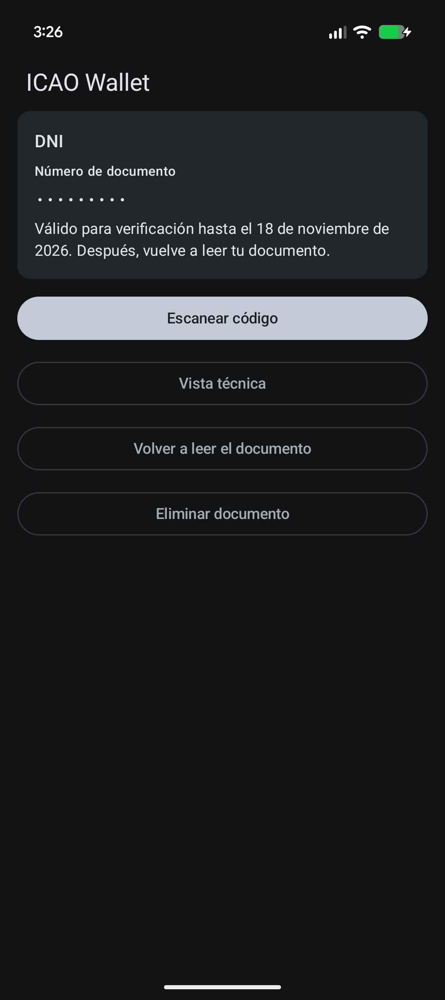
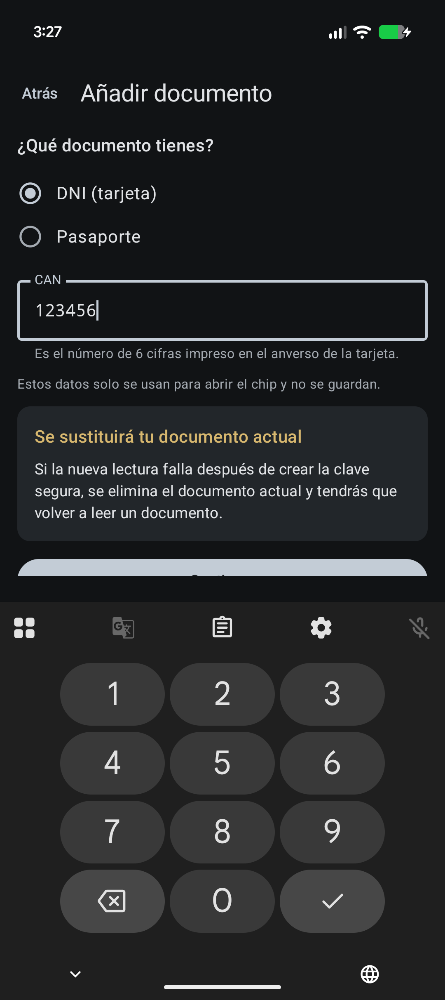
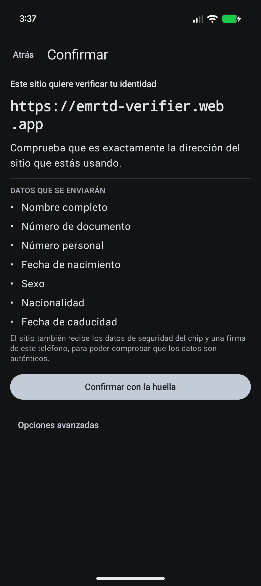
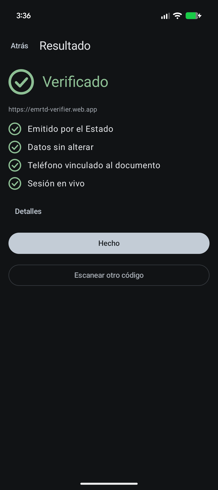
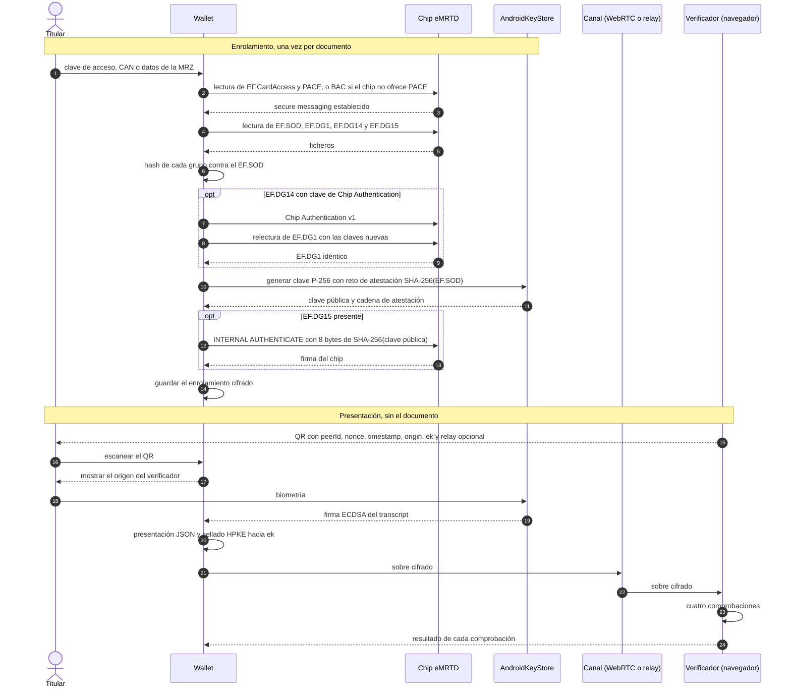

# eudi-icao-android-wallet

[English version](README.en.md)

Aplicación Android nativa que lee por NFC el chip ICAO 9303 de un DNIe español o de un pasaporte, vincula el
documento a una clave P-256 guardada en AndroidKeyStore y lo presenta a un verificador que se ejecuta en un
navegador. Es la mitad móvil de un experimento de investigación. La otra mitad, con las anclas de confianza y toda
la verificación criptográfica, está en el repositorio `eudi-icao-web-verifier`.

Es código de investigación. Compila, sus pruebas JVM pasan y se ha ejecutado de extremo a extremo con un DNIe y un
pasaporte españoles en un único teléfono. El apartado [Estado de verificación](#estado-de-verificación)
detalla qué está comprobado y qué no.

## Capturas

<p>
  
  
  
  
</p>

Pantalla principal con el número de documento tapado, alta con un CAN de ejemplo, confirmación antes de enviar y
resultado devuelto por el verificador. Están tomadas con una build compilada con `-PwalletAllowScreenCapture=true`;
la build publicada bloquea las capturas.

## Planteamiento

El caso es concreto: demostrar ante una web la posesión de un documento de identidad emitido por el Estado. El chip
ICAO 9303 que ya llevan el DNIe y el pasaporte contiene datos firmados por el Estado. El EF.SOD es un CMS SignedData
firmado por un Document Signer que emite la CSCA SPAIN de la Dirección General de la Policía, y cualquiera puede
verificarlo con un certificado público. En el momento de la verificación no interviene ningún servidor del emisor y
no hay que solicitar una credencial nueva a un proveedor.

En el modelo de eIDAS 2.0 (Reglamento (UE) 2024/1183, EUDI Wallet) la verificación de una presentación tampoco
contacta con el emisor en tiempo real. La dependencia está en otro sitio: el PID lo emite un proveedor designado
hacia una cartera certificada (OpenID4VCI), las atestaciones son de vida corta y se reemiten por lotes para limitar
la correlación, la cartera necesita una atestación de su proveedor, las partes usuarias deben registrarse y obtener
certificados de acceso, y la revocación se publica en listas de estado. Son puntos de control y de disponibilidad
nuevos.

El documento físico ya emitido resuelve una parte del problema, los atributos firmados por el Estado, sin esa
infraestructura. No resuelve otras: divulgación selectiva, no vinculabilidad, vínculo con el titular y revocación.
Este repositorio explora la primera parte y deja escrito dónde se queda corta.

## Hallazgo sobre el DNIe

El diseño inicial preveía que el chip firmase, con Active Authentication (INTERNAL AUTHENTICATE), un reto derivado
de la clave del móvil. Ese diseño no es ejecutable sobre un DNIe.

El DNIe 3.0/4.x y el pasaporte español 4.x no exponen EF.DG15 ni implementan Active Authentication. Solo ofrecen
Chip Authentication v1 mediante EF.DG14. Las fuentes son la librería jmulticard del Gobierno de España (clase
`Dnie3`: "Este MRTD no tiene DG15") y las declaraciones de seguridad Common Criteria de la FNMT-RCM para "Tarjeta
DNIe 4.0/4.01/4.02" y "Pasaporte electrónico 4.0/4.01", publicadas por el Organismo de Certificación del CCN. El
EF.SOD de muestra del DNIe 3.0 lista los grupos 1, 2, 3, 7, 11, 13 y 14. La lectura con esta aplicación de un DNIe
y un pasaporte en vigor lo confirma: ninguno de los dos EF.SOD lista EF.DG15.

Chip Authentication es un acuerdo de claves. Demuestra la autenticidad del chip al terminal que lo ejecuta, pero no
deja ninguna prueba que un tercero pueda verificar. De ahí salen los dos modos de vínculo que implementa esta
aplicación, descritos en [Vínculo chip-dispositivo](#vínculo-chip-dispositivo).

El análisis completo del lado de la verificación (anclas CSCA, Passive Authentication, validación de la atestación,
política) está en `eudi-icao-web-verifier`.

## Flujos de la aplicación

La aplicación tiene dos flujos. El enrolamiento necesita el documento y se hace una vez. La presentación usa lo
guardado en el enrolamiento y la clave del dispositivo; el documento ya no interviene.

La interfaz está en español y en inglés y sigue el idioma del sistema; en Android 13 o posterior se puede elegir
por aplicación en los ajustes. Los identificadores técnicos (EF.SOD, PACE, OID, nombres de algoritmo) y los nombres
de los pasos del registro no se traducen.

El recorrido por defecto es sencillo: añadir el documento, escanear el código, confirmar con la huella y ver el
resultado. El detalle criptográfico queda en la vista técnica, accesible desde la pantalla principal. Los datos
personales aparecen ocultos por defecto: el número de documento se muestra con solo sus tres últimos caracteres, la
pantalla de confirmación lista qué categorías de datos se envían sin mostrar sus valores, y en la vista técnica la
MRZ y sus campos hay que descubrirlos con un control expreso.

### Enrolamiento

Lo ejecuta `DniEPassportReader` sobre JMRTD 0.8.9 y SCUBA. Cualquier paso que no pueda completarse aborta el
enrolamiento; no hay caminos degradados. El fallo se clasifica (clave de acceso incorrecta, contacto perdido, NFC
apagado, sin biometría fuerte y otros) y se muestra con un mensaje en el idioma de la interfaz; el detalle técnico
queda disponible aparte.

1. El titular elige el tipo de documento y acerca el documento al teléfono. Para el DNIe introduce el CAN (6
   dígitos impresos en el anverso). Para el pasaporte, donde no suele haber CAN impreso, introduce los datos de la
   MRZ: número de documento, fecha de nacimiento y fecha de caducidad, escritas como DD/MM/AAAA y convertidas al
   formato de la MRZ por la aplicación. El modo lector NFC (NFC-A y NFC-B, sin comprobación NDEF) solo está
   armado mientras la pantalla de enrolamiento espera o lee.
2. Lectura de EF.CardAccess y PACE con esa clave. Entre los PACEInfo ofrecidos se prefiere ECDH, AES y Generic
   Mapping. Si la clave son datos de la MRZ y el chip no ofrece PACE (no hay EF.CardAccess o no contiene PACEInfo),
   se recurre a BAC con la misma clave. Con un CAN no hay alternativa: un documento sin PACE se rechaza.
3. Selección de la aplicación eMRTD y lectura de EF.SOD, EF.DG1 y, si el SOD los lista, EF.DG14 y EF.DG15. No se
   lee ningún otro grupo de datos; la fotografía (EF.DG2) no sale del chip.
4. Comprobación de integridad: el hash de cada fichero leído se compara con su entrada en el SOD. El algoritmo se
   toma de `LDSSecurityObject.hashAlgorithm`; no se presupone SHA-256 (el SOD de muestra del DNIe 3.0 usa SHA-1).
5. Si EF.DG14 contiene una clave pública de Chip Authentication, se ejecuta Chip Authentication v1 contra ella.
   Cuando el chip ofrece varias combinaciones se elige AES antes que 3DES y la clave más larga. A continuación se
   relee EF.DG1 con las claves de secure messaging nuevas, sin caché, y se compara byte a byte con la primera
   lectura. Si la relectura falla o difiere, el enrolamiento se aborta.
6. Solo entonces se genera la clave del dispositivo en AndroidKeyStore: EC P-256, uso exclusivo de firma con
   SHA-256, biometría de clase 3 obligatoria en cada operación e invalidación si se registra una biometría nueva.
   Se pide en StrongBox cuando el dispositivo lo declara y, si no está disponible, en el keystore por defecto. El
   reto de atestación es `SHA-256(EF.SOD)`.
7. Si el documento tiene EF.DG15, se envía INTERNAL AUTHENTICATE con `RND.IFD` igual a los 8 primeros bytes de
   `SHA-256(SubjectPublicKeyInfo de la clave del dispositivo)` y se guarda la respuesta del chip.
8. El resultado se guarda cifrado. El modo de vínculo queda fijado: `aa` si hubo Active Authentication,
   `ca-attestation` en caso contrario. En `ca-attestation`, si AndroidKeyStore no devuelve una cadena de
   atestación, el enrolamiento falla.

Un documento que no ofrece ni EF.DG15 ni una clave de Chip Authentication en EF.DG14 se rechaza. La lectura
completa tiene un límite de 60 segundos.

El wallet no ejecuta Passive Authentication: no incluye anclas CSCA. La comparación de hashes del paso 4 es una
comprobación de coherencia contra un SOD cuya firma solo valida el verificador.

Solo hay un documento enrolado a la vez. Un nuevo enrolamiento borra el anterior en el momento de generar la clave
nueva; si la lectura falla después de ese punto, no queda ningún enrolamiento.

### Presentación

1. El verificador muestra un QR con el descriptor de sesión. El wallet lo lee con la cámara (CameraX y ML Kit, solo
   códigos QR).
2. El descriptor se valida antes de mostrar nada: versión 1, `nonce` de 32 bytes, `ek` como punto P-256 sin
   comprimir y sobre la curva, `timestamp` a menos de 5 minutos del reloj del teléfono, `origin` con forma de
   origen http o https sin ruta, y `relay`, si viene, sin query, fragmento ni barra final.
3. La pantalla de confirmación muestra el origen del verificador en grande, las categorías de datos que se van a
   enviar y un aviso cuando el origen no es `https`. El transporte, los datos de la sesión y la opción de
   demostración quedan en "Opciones avanzadas", plegadas por defecto.
4. Al confirmar, el wallet construye el transcript `"eudi-icao-auth-v1\n" + nonce + "\n" + origin` y pide la firma
   a AndroidKeyStore. El BiometricPrompt repite el origen como subtítulo. La firma es ECDSA P-256 con SHA-256, en
   DER.
5. Se monta la presentación en JSON con los bytes exactos leídos del chip (EF.DG1, EF.DG14, EF.DG15, EF.SOD), la
   clave pública del dispositivo, el modo de vínculo, la respuesta de INTERNAL AUTHENTICATE en modo `aa`, la cadena
   de atestación si existe, y la firma del transcript.
6. La presentación se cifra con HPKE (RFC 9180, modo base, DHKEM P-256, HKDF-SHA256, AES-128-GCM) hacia la clave
   efímera `ek` del verificador, con `info = "eudi-icao-presentation-v1"` y el `nonce` como AAD.
7. El sobre cifrado se entrega por el transporte elegido y el wallet espera el resultado.
8. La pantalla muestra el veredicto del verificador y el estado de sus cuatro comprobaciones: Passive
   Authentication, Data Integrity, Chip-to-Device Binding y Live Nonce Proof.

La antigüedad del descriptor se comprueba de nuevo antes y después de la firma. La sesión se da por consumida en
cuanto empieza la entrega, porque el verificador la consume con la primera presentación que recibe, válida o no.

Entre las opciones avanzadas hay una de demostración que envía EF.DG1 alterado: cambia el primer carácter del
número de documento antes de enviar. El hash deja de coincidir con el SOD y la comprobación Data Integrity del
verificador debe fallar.

### Diagrama de secuencia



### Transporte

El canal principal es un WebRTC DataChannel abierto con PeerJS. Para hablar exactamente el mismo protocolo que el
navegador, el wallet carga la build de navegador de peerjs 1.5.5, incluida en los assets, en un WebView fuera de
pantalla. Ese WebView solo recibe el sobre ya cifrado, troceado en tramas de 8000 caracteres como máximo. El wallet
usa siempre el servidor de señalización en la nube de PeerJS (`0.peerjs.com`) y los servidores ICE por defecto de
la librería.

El relay HTTP es opcional y solo está disponible si el descriptor trae `relay`. El wallet hace un PUT del sobre
(262144 bytes como máximo) en el buzón de la sesión y consulta `{relay}/result?wait=25` hasta recibir el resultado,
con al menos un segundo entre consultas y un límite total de 60 segundos. Un relay `http://` solo funciona en la
build de depuración, que es la única que permite tráfico en claro.

La presentación sale del wallet ya sellada con HPKE. El servidor de señalización de PeerJS y el relay solo ven
texto cifrado.

## Prueba de mayoría de edad (experimental)

Esta rama añade una tercera forma de responder a un verificador. Cuando el descriptor de sesión trae
`"request": "age-over-18"`, el wallet no envía EF.DG1 ni EF.SOD: genera en el teléfono una prueba de conocimiento
cero de que el titular tiene 18 años o más y envía solo esa prueba, sus valores públicos y el certificado del
Document Signer. El circuito, lo que demuestra y la verificación están descritos en `eudi-icao-web-verifier`.

Pasos, tras escanear el QR:

1. La pantalla de confirmación indica que el sitio solo quiere comprobar la mayoría de edad, qué se envía (la
   prueba, el certificado de la autoridad que firmó el documento y la fecha de hoy) y qué no (nombre, número de
   documento, fecha de nacimiento). El titular confirma con BiometricPrompt de clase 3. En este flujo no se usa la
   clave del dispositivo ni la atestación.
2. Las entradas del circuito se calculan a partir del EF.DG1 y el EF.SOD guardados (`zk/AgeProofInputs.kt`), con la
   fecha UTC del día y un reto derivado del nonce y del origen de la sesión.
3. El testigo se calcula con el generador WebAssembly del circuito en un WebView fuera de pantalla que solo puede
   cargar sus propios ficheros (`zk/WitnessCalculator.kt`).
4. La prueba Groth16 la genera la librería nativa rapidsnark (`zk/Groth16Prover.kt`) con la clave de prueba.
5. El texto en claro se sella con HPKE y se entrega por los mismos transportes que la presentación completa. El
   resultado muestra las tres comprobaciones del verificador.

La clave de prueba pesa 243 MB y no va en el APK. La aplicación la descarga la primera vez, desde la Release de
este repositorio, a su almacenamiento privado, y solo la acepta si su tamaño y su SHA-256 coinciden con los
fijados en la build. La vista técnica muestra su estado y permite importarla desde un fichero o eliminarla.

Medido en un teléfono con un pasaporte español real (15 de noviembre de 2026): entradas en 10 ms, testigo en
3,0 s (14,6 MB), prueba en 2,6 s, sellado en 37 ms y entrega en 1,4 s; 8,6 s en total con la huella. El texto en
claro ocupó 3463 bytes, de los que 1421 son el certificado. El verificador lo aceptó.

Lo que no demuestra:

- No demuestra posesión del documento. Quien tenga el EF.DG1 y el EF.SOD de un adulto puede generar pruebas
  válidas sin el chip y sin este teléfono, y no hay nada que lo limite o lo revoque.
- El certificado del Document Signer viaja en claro y revela el tipo de documento y el periodo de uso de esa
  clave.
- La clave de prueba procede de una ceremonia con una sola contribución: es una demostración.

## Vínculo chip-dispositivo

La firma del nonce en cada sesión la hace la clave del dispositivo, no el chip. Lo que da valor a esa firma es la
prueba de que la clave quedó ligada a un chip auténtico durante el enrolamiento. Hay dos formas de dar esa prueba.

### Modo `aa`

Se usa cuando el documento expone EF.DG15. El chip firma con INTERNAL AUTHENTICATE los 8 primeros bytes de
`SHA-256(clave pública del dispositivo)`, y el verificador comprueba esa firma con la clave de EF.DG15, cuyo hash
está en el SOD. La prueba es criptográfica y transferible, pero el vínculo es de 64 bits, que es el máximo que
permite el reto de Active Authentication.

El wallet no verifica la firma del chip; solo comprueba que la respuesta tiene la longitud que corresponde a la
clave de EF.DG15. La verificación es tarea del verificador.

### Modo `ca-attestation` (perfil DNIe)

Se usa cuando el documento tiene EF.DG14 con una clave de Chip Authentication y no tiene EF.DG15. Como Chip
Authentication no deja una prueba transferible, la prueba que recibe el verificador es la atestación de la clave
del dispositivo (Android Key Attestation), cuyo reto es `SHA-256(EF.SOD)`.

El argumento de confianza tiene tres eslabones y conviene separarlos.

1. Passive Authentication y Data Integrity, en el verificador. El SOD presentado está firmado por un Document
   Signer bajo una CSCA fijada, y los hashes de EF.DG1 y EF.DG14 coinciden con él. Por tanto la clave pública de
   Chip Authentication de EF.DG14 es la que el Estado puso en ese documento.
2. La atestación, en el verificador. La cadena de certificados llega a una raíz de atestación de Google fijada. El
   certificado hoja atesta la misma clave pública que firma el nonce, generada dentro de hardware seguro (TEE o
   StrongBox) como clave EC P-256 de firma. El reto atestado es el hash del SOD presentado. Con la política por
   defecto, el dispositivo arrancó en estado verificado con el bootloader bloqueado. La aplicación que pidió la
   clave tiene el nombre de paquete y la huella del certificado de firma fijados en la política del verificador.
3. El comportamiento de la build atestada, que nadie verifica en tiempo de ejecución. En el código de este
   repositorio, la única llamada que genera la clave del dispositivo está en el callback `bindDeviceKey` de
   `WalletViewModel`, y `DniEPassportReader` solo lo invoca después de que el control de acceso (PACE o BAC) haya tenido éxito, los
   hashes de EF.DG1 y EF.DG14 coincidan con el SOD, Chip Authentication se haya completado contra la clave de
   EF.DG14 y EF.DG1 se haya releído sin cambios bajo las claves derivadas de ese acuerdo.

Si los tres eslabones se sostienen, la existencia de la atestación implica que un chip con la clave privada
correspondiente a EF.DG14 respondió por NFC a ese teléfono y que quien lo operaba conocía el CAN o los datos de la MRZ. No hay medida de
distancia: un chip alcanzado a través de un relé NFC cumple la misma condición.

Qué prueba la atestación por sí sola: que una clave hardware fue generada por esa build concreta con ese reto.
Qué no prueba: la presencia del chip y el éxito de Chip Authentication no quedan firmados por el documento. Se
apoyan en la integridad de la build atestada, es decir, en el eslabón 3.

Condiciones de las que depende el eslabón 3:

- El EF.SOD no es secreto. Lo tiene cualquiera que haya leído el chip una vez, y lo recibe cada verificador en cada
  presentación junto con EF.DG1 y EF.DG14. Calcular su hash y pedir una atestación con ese reto es trivial. Lo único
  que separa a ese tercero de un enrolamiento válido es que la atestación delataría otra aplicación u otro estado
  de arranque. Sin fijar la identidad de la aplicación y exigir arranque verificado, la atestación no dice nada
  sobre el documento.
- La clave de firma del wallet solo debe firmar builds no depurables del código auditado. El campo
  `attestationApplicationId` contiene el paquete, la versión y la huella del certificado; no distingue una build
  depurable. En una build de depuración, quien tenga el teléfono con la depuración USB autorizada puede ejecutar
  código dentro del proceso y pedir una clave con el reto que quiera. Además, la clave de depuración de Android es
  local a cada máquina y su contraseña es pública. Fijar la huella de una build de depuración sirve para ensayar el
  flujo, no para sostener este argumento.
- La PKI de atestación de Google y el TEE del fabricante deben ser fiables. Una clave de atestación filtrada o un
  TEE comprometido permiten fabricar atestaciones.
- El código del wallet no debe tener fallos que permitan llegar a la generación de la clave con un SOD elegido.

Este modo introduce como anclas de confianza la PKI de atestación de Google y la clave de firma del wallet, además
de la CSCA. Es una dependencia de terceros que el planteamiento inicial quería evitar.

### Qué queda fuera en ambos modos

La presencia del chip se establece en el enrolamiento, no en cada presentación. Una presentación prueba el control,
con biometría, de la clave que se vinculó al chip en su momento. La biometría es la del teléfono: demuestra que
firma alguien registrado en ese dispositivo, no que sea el titular del documento. El wallet no compara ningún rasgo
de la persona con el documento.

## Protocolo

Resumen de lo que el wallet consume y emite. Los nombres de campo son los del código en `protocol/`.

Descriptor de sesión (contenido del QR, del verificador al wallet):

```json
{"v":1,"peerId":"...","nonce":"<base64url, 32 bytes>","timestamp":1731600000000,
 "origin":"https://host","ek":"<base64url, punto P-256 de 65 bytes>","relay":"<opcional>"}
```

Sobre cifrado (del wallet al verificador):

```json
{"v":1,"type":"sealed","enc":"<base64, clave encapsulada de 65 bytes>","ct":"<base64, texto cifrado y tag>"}
```

Presentación (texto en claro dentro del sobre):

| Campo | Contenido |
| --- | --- |
| `v`, `nonce`, `origin` | versión 1 y los valores del descriptor, sin modificar |
| `dg1`, `dg14`, `dg15`, `sod` | bytes exactos leídos del chip, en base64; `dg14` y `dg15` solo si existen |
| `devicePublicKey` | SubjectPublicKeyInfo DER de la clave P-256 del dispositivo |
| `binding` | `aa` o `ca-attestation` |
| `chipSignatureOverDeviceKey` | respuesta de INTERNAL AUTHENTICATE; solo en modo `aa` |
| `keyAttestation` | cadena de atestación X.509, hoja primero; obligatoria en `ca-attestation` |
| `deviceSignatureOverNonce` | firma ECDSA en DER sobre el transcript |
| `device` | modelo, versión de Android y tipo de almacenamiento de la clave; informativo, no verificable |

Valores derivados: `aaChallenge` son los 8 primeros bytes de `SHA-256(devicePublicKey)`; `attestationChallenge` es
`SHA-256(sod)`; el transcript es el texto UTF-8 `"eudi-icao-auth-v1\n" + nonce + "\n" + origin`.

Tramas del canal PeerJS: el sobre viaja como `{"t":"part","i":<índice>,"n":<total>,"d":"<fragmento>"}` y el
resultado vuelve como `{"t":"result","ok":<bool>,"checks":[{"id":"...","status":"pass|fail|skipped"}]}`.

## Datos en el dispositivo y conexiones de red

- El enrolamiento se guarda en un único fichero bajo `noBackupFilesDir`, cifrado con AES-256-GCM con una clave de
  AndroidKeyStore. Contiene EF.CardAccess, EF.SOD, EF.DG1, EF.DG14, EF.DG15, la clave pública del dispositivo, la
  respuesta de Active Authentication, la cadena de atestación y el registro de pasos de la lectura. La aplicación
  declara `allowBackup="false"`.
- La clave de acceso (CAN o datos de la MRZ) se usa para PACE o BAC y no se guarda. Permanece en memoria hasta que
  el enrolamiento termina bien.
- La clave privada del dispositivo no sale de AndroidKeyStore. Si el sistema la invalida (alta de una biometría
  nueva o eliminación del bloqueo de pantalla), el siguiente intento de presentación borra el enrolamiento y pide
  repetirlo.
- La aplicación no registra datos personales, contenido de ficheros, la clave de acceso ni material de clave. Los loggers de
  `org.jmrtd` y `net.sf.scuba`, que vuelcan APDU, están silenciados.
- En builds no depurables la ventana lleva `FLAG_SECURE`: la MRZ y los datos personales no aparecen en capturas ni
  en la vista de aplicaciones recientes. Sí permiten capturas la build de depuración y una build compilada con
  `-PwalletAllowScreenCapture=true`, pensada para documentar la interfaz y no para distribuirse.
- Conexiones salientes: el servidor de señalización de PeerJS y sus servidores ICE (un STUN de Google y los TURN de
  PeerJS), o el relay indicado en el descriptor. Además, la librería ML Kit que decodifica el QR trae consigo el
  componente de telemetría de Google (`datatransport`) y puede enviar métricas de uso a Google cuando se usa el
  escáner. La decodificación se hace en el dispositivo con el modelo incluido en el APK.

La vista técnica muestra todo lo guardado: MRZ con sus dígitos de control (oculta por defecto), hash de cada fichero
y su comparación con el SOD, resumen del SOD y del Document Signer, el control de acceso empleado (PACE o BAC y con
qué clave), los parámetros de Chip Authentication, la cadena de atestación decodificada (nivel de seguridad, reto,
estado de arranque, `attestationApplicationId`) con la fecha hasta la que es válida, el registro de pasos del
enrolamiento y la identidad de la build. Sin documento enrolado, la vista técnica muestra el estado del dispositivo
y la identidad de la build. La pantalla principal indica hasta qué fecha es válida la cadena de atestación y avisa
cuando ha caducado.

## Estructura del código

Un solo módulo, `:app`. Fuentes en `app/src/main/kotlin/dev/eudisovereign/icaowallet`, pruebas JVM en
`app/src/test/kotlin/dev/eudisovereign/icaowallet`.

| Paquete | Contenido |
| --- | --- |
| (raíz) | `MainActivity`: aloja Compose, arma el modo lector NFC durante el enrolamiento, `FLAG_SECURE` |
| `crypto` | `Codec` (hex, base64, hashes), `Hpke` (RFC 9180 sobre BouncyCastle), `KeystoreManager` (clave del dispositivo, atestación, firma con BiometricPrompt) |
| `data` | `Enrollment` (documento enrolado, serializable) y `EnrollmentStore` (fichero AES-256-GCM) |
| `nfc` | `DniEPassportReader` (secuencia de enrolamiento sobre JMRTD), `AccessKey` (CAN o datos de la MRZ), `DocumentSecurity` (SOD, parámetros de Chip Authentication, algoritmos de Active Authentication), `NfcReaderMode` |
| `protocol` | `SessionDescriptor`, `Presentation`, `Derivation`, `SealedEnvelope`, `PartFrame`, `ResultFrame` |
| `report` | `DocumentReport`, `Attestation` (decodificación de KeyDescription), `Mrz`, `BuildIdentity`: datos de la vista técnica |
| `transport` | `Transport`, `PeerJsTransport` (peerjs en WebView), `RelayTransport` (OkHttp) |
| `ui` | `WalletViewModel` (único poseedor de estado), tipos de estado y pantallas Compose: Home, Enrolment, Scanner, Presentation, Technical. `Problem` (categorías de fallo), `Texts` (paso de categorías a recursos de texto), `DateInput`, `Masking`, `ReadProgress` |

Los textos están en `app/src/main/res/values/strings.xml` (inglés) y `values-es/strings.xml` (español).

`app/src/main/assets/peerjs` contiene la build de navegador de peerjs 1.5.5 y su licencia. Las versiones de todas
las dependencias están en `gradle/libs.versions.toml`. Las principales: JMRTD 0.8.9, scuba-sc-android 0.0.27,
BouncyCastle 1.86, androidx.biometric 1.1.0, CameraX 1.6.2, ML Kit barcode-scanning 17.3.0, OkHttp 5.5.1.

## Compilación e instalación

Los comandos son para Windows PowerShell, desde la raíz del repositorio.

### APK publicado

Las Releases del repositorio incluyen el APK de `release` firmado, que es la build que fija la política del
verificador publicado en <https://emrtd-verifier.web.app>. La huella SHA-256 de su certificado de firma es
`7f39f1b663b09c1485acb934f340a9c772bb90e90c2d1a6bfb4dacf6ee5d02a1`; puede comprobarse con `apksigner` como se
indica más abajo. Requiere Android 8.0 o posterior, NFC y una biometría de clase 3 registrada. Al no proceder de
una tienda, Android pide permitir la instalación desde el origen usado y puede mostrar un aviso de Play Protect.

Un APK compilado a partir de este código lleva otra firma, y el verificador publicado lo rechaza hasta que su
huella se fije en la política.

### Requisitos

- JDK 17 o posterior. La compilación se ha hecho con Temurin 21.
- Android SDK con la plataforma 37 (`platforms;android-37.0`), build-tools 37.0.0 y platform-tools.
- El wrapper descarga Gradle 9.5.1. AGP 9.3.3 compila Kotlin 2.4.21 por sí mismo; el plugin
  `org.jetbrains.kotlin.android` no se aplica.
- Para ejecutar la aplicación: un teléfono con Android 8.0 (API 26) o posterior, NFC, una biometría de clase 3
  registrada y cámara. Para el modo `ca-attestation` el teléfono debe tener atestación de clave por hardware,
  arranque verificado y bootloader bloqueado. Un emulador no sirve.

La ubicación del SDK se indica con la variable `ANDROID_HOME` o con `sdk.dir` en `local.properties`, que git
ignora.

```powershell
$env:JAVA_HOME = 'C:\ruta\al\jdk'
$env:ANDROID_HOME = 'C:\ruta\al\android-sdk'
```

### Smart App Control y aapt2

En Windows con Smart App Control los binarios nativos sin firma no se ejecutan. El `aapt2.exe` que AGP descarga de
Maven no está firmado, así que Smart App Control lo bloquea. El `aapt2.exe` de las build-tools 37.0.0 del SDK sí
lleva firma Authenticode. Se indica a AGP que use ese con la propiedad `android.aapt2FromMavenOverride` en el
`gradle.properties` del usuario, no en el del repositorio, porque es una ruta absoluta de cada máquina:

```powershell
$gradleHome = if ($env:GRADLE_USER_HOME) { $env:GRADLE_USER_HOME } else { "$env:USERPROFILE\.gradle" }
New-Item -ItemType Directory -Force -Path $gradleHome | Out-Null
$aapt2 = "$env:ANDROID_HOME\build-tools\37.0.0\aapt2.exe"
Add-Content -LiteralPath "$gradleHome\gradle.properties" -Value ('android.aapt2FromMavenOverride=' + $aapt2.Replace('\', '\\'))
```

La línea resultante lleva las barras invertidas duplicadas, como exige el formato de propiedades:

```properties
android.aapt2FromMavenOverride=C:\\ruta\\al\\android-sdk\\build-tools\\37.0.0\\aapt2.exe
```

AGP avisa en cada compilación de que la opción es experimental. Sin Smart App Control este paso no hace falta.

### Compilar, probar e instalar

```powershell
.\gradlew.bat assembleDebug
.\gradlew.bat testDebugUnitTest
& "$env:ANDROID_HOME\platform-tools\adb.exe" install -r app\build\outputs\apk\debug\app-debug.apk
```

El APK de depuración queda en `app\build\outputs\apk\debug\app-debug.apk`, firmado con la clave de depuración
local. Es depurable: sirve para ensayar el flujo, no para que un verificador fije su huella.

### Build de release firmada

La configuración de firma de `release` se crea solo cuando están definidas las cuatro propiedades de Gradle
`walletKeystoreFile`, `walletKeystorePassword`, `walletKeyAlias` y `walletKeyPassword`. Se leen del
`gradle.properties` del usuario o de `-P`, nunca del repositorio. Sin ellas, `assembleRelease` produce
`app-release-unsigned.apk`; no se recurre nunca a la clave de depuración. Con solo algunas, la compilación se
detiene indicando cuáles faltan. La minificación sigue desactivada.

Crear el almacén de claves fuera del repositorio (`keytool` pide la contraseña):

```powershell
& "$env:JAVA_HOME\bin\keytool.exe" -genkeypair -keystore "$env:USERPROFILE\wallet-release.p12" -storetype PKCS12 -alias wallet -keyalg EC -groupname secp256r1 -validity 3650 -dname "CN=eudi-icao-android-wallet"
```

Declarar las propiedades en el `gradle.properties` del usuario (el de `GRADLE_USER_HOME`, por defecto
`%USERPROFILE%\.gradle`), con la ruta absoluta del almacén:

```properties
walletKeystoreFile=C:/Users/<usuario>/wallet-release.p12
walletKeystorePassword=<contraseña>
walletKeyAlias=wallet
walletKeyPassword=<contraseña>
```

Compilar e instalar:

```powershell
.\gradlew.bat assembleRelease
& "$env:ANDROID_HOME\platform-tools\adb.exe" install -r app\build\outputs\apk\release\app-release.apk
```

Quien tenga esa clave puede firmar una build que el verificador aceptará como este wallet: su custodia forma parte
del argumento de confianza del modo `ca-attestation`.

Dos pruebas usan el EF.SOD de muestra del DNIe 3.0 que jmulticard incluye entre sus recursos de prueba
(`SOD_ESPECIMEN.der`). El fichero no se distribuye en este repositorio. Para ejecutarlas hay que copiarlo en
`app\src\test\resources\external\`; si falta, esas dos pruebas se omiten y el resto se ejecuta.

## Huella del certificado de firma para la política de atestación

En modo `ca-attestation` el verificador solo acepta atestaciones de las aplicaciones listadas en `allowedApps` de
su política (`public/config/attestation-policy.json` en `eudi-icao-web-verifier`). En ese repositorio la lista
está vacía y, mientras lo esté, la comprobación Chip-to-Device Binding falla. Cada entrada lleva el nombre de
paquete y el SHA-256 del certificado de firma del APK, en hexadecimal sin separadores:

```json
{
  "minSecurityLevel": "tee",
  "requireVerifiedBoot": true,
  "allowedApps": [
    { "packageName": "dev.eudisovereign.icaowallet", "signingCertSha256": ["<64 dígitos hexadecimales>"] }
  ]
}
```

La huella se obtiene de tres maneras.

En la aplicación. La pantalla principal tiene el apartado "Wallet build identity", visible haya o no un documento
enrolado: nombre de paquete, SHA-256 del certificado de firma y un botón que copia la entrada `allowedApps` ya
formada. En una build depurable añade el aviso "Debuggable build: its signing certificate must not be pinned by a
verifier." La vista técnica repite el apartado y, en "Binding", muestra además el `attestationApplicationId` tal
como lo atestó el keystore y lo compara con la build en ejecución; ese es el valor que verá el verificador.

Con `apksigner`, sobre el APK ya compilado (el de `release` queda en
`app\build\outputs\apk\release\app-release.apk`). La línea `certificate SHA-256 digest` da la huella en el formato
que espera la política:

```powershell
& "$env:ANDROID_HOME\build-tools\37.0.0\apksigner.bat" verify --print-certs app\build\outputs\apk\debug\app-debug.apk
```

Con `keytool`, sobre el almacén de claves. Para la clave de depuración, quitando los dos puntos y pasando a
minúsculas:

```powershell
$line = & "$env:JAVA_HOME\bin\keytool.exe" -list -v -keystore "$env:USERPROFILE\.android\debug.keystore" -alias androiddebugkey -storepass android | Select-String 'SHA256:'
($line.Line -replace '.*SHA256:\s*', '' -replace ':', '').ToLower()
```

`keytool -printcert -jarfile` no sirve con este APK: no lleva firma JAR (esquema v1) y keytool no lee los esquemas
de firma de APK.

La huella de una build de depuración es distinta en cada máquina que compila y no debe fijarse en un verificador
que pretenda algo más que ensayar el flujo: véase lo dicho en
[Modo `ca-attestation`](#modo-ca-attestation-perfil-dnie) sobre lo que vale una build depurable. La huella que
corresponde fijar es la de la build de `release` firmada con la clave propia.

## Estado de verificación

Comprobado, en Windows 11 con Temurin JDK 21, Gradle 9.5.1 y AGP 9.3.3:

- `assembleDebug` compila y empaqueta el APK de depuración sin errores.
- `testDebugUnitTest` ejecuta 145 pruebas JVM en 20 clases, sin fallos y sin omisiones cuando el SOD de muestra
  está presente.
- `assembleRelease` produce un APK sin firmar cuando faltan las propiedades de firma y uno firmado cuando están
  las cuatro; la firma se comprobó con `apksigner` y el APK firmado se instaló y se usó en un teléfono.

Las pruebas JVM cubren la lógica que no depende de Android:

- HPKE: apertura del vector del apéndice A.3 de RFC 9180, ida y vuelta con el `info` y el AAD del protocolo, y
  rechazo de texto cifrado, tag, AAD, `info` o claves alterados.
- Descriptor de sesión: casos válidos y motivos de rechazo, incluido el desbordamiento del `timestamp`.
- Clave de acceso: validación del CAN y de los datos de la MRZ, la semilla de BAC contra el ejemplo del apéndice D
  de la parte 11 del Doc 9303, y los mensajes de clave incorrecta según el protocolo y el código de estado.
- Cadena de atestación: cálculo del primer certificado que caduca, con certificados generados en la prueba.
- Presentación: valores derivados contra un cálculo independiente, miembros exactos del JSON en cada modo, reglas
  de presencia, troceado en tramas, análisis de la trama de resultado y apertura del sobre con la clave del
  verificador.
- EF.SOD: JMRTD analiza el SOD de muestra del DNIe 3.0 y devuelve SHA-1 como algoritmo de los grupos de datos, los
  grupos 1, 2, 3, 7, 11, 13 y 14 y el Document Signer `DS n-eID SPAIN 2`. La firma del SOD no se verifica aquí.
- Selección de parámetros de Chip Authentication (por `keyId`, cifrado más fuerte, inferencia del protocolo cuando
  EF.DG14 solo trae la clave) y nombres de algoritmo de Active Authentication.
- Lectura de ficheros con el `CardFileInputStream` real de SCUBA sobre un sistema de ficheros simulado, incluido el
  rechazo de longitudes declaradas inverosímiles.
- Serialización del enrolamiento y contenedor AES-256-GCM, con una clave AES de la JVM en lugar de AndroidKeyStore.
- Decodificación de la extensión KeyDescription sobre extensiones construidas en la prueba.
- MRZ (TD1 y TD3, dígitos de control), construcción de la página de PeerJS y ritmo de consulta del relay contra un
  interceptor de OkHttp.
- Interfaz: conversión de fechas DD/MM/AAAA al formato de la MRZ con sus casos inválidos, ocultación de datos
  personales, clasificación de fallos y agrupación de los pasos de lectura en fases.
- Prueba de mayoría de edad: entradas del circuito contra vectores compartidos con el verificador en los dos
  perfiles, reto de sesión, descriptor con y sin `request`, texto en claro, trama de resultado y descarga de la
  clave de prueba (redirecciones solo por https, hash, cuerpo truncado, cancelación y espacio insuficiente).

Ejecución en un dispositivo (14 de noviembre de 2026), con la build de depuración en un teléfono Android con
StrongBox (Android 17) y un pasaporte español en vigor:

- Enrolamiento completo con datos de la MRZ: EF.CardAccess (114 bytes), PACE ECDH-GM con AES-128 y parámetros
  estandarizados 13 (brainpoolP256r1), EF.SOD (2180 bytes), EF.DG1 y EF.DG14; hashes SHA-1 conformes con el SOD;
  Chip Authentication con canal 3DES y relectura idéntica de EF.DG1 bajo las claves nuevas; clave del dispositivo
  en StrongBox con reto de atestación y cadena de 5 certificados. El SOD no lista EF.DG15 y Active Authentication
  se omitió: el vínculo quedó en `ca-attestation`.
- Presentación por PeerJS desde el WebView, con escaneo del QR y firma tras BiometricPrompt, aceptada por el
  verificador con las cuatro comprobaciones superadas.
- Con un dato de la MRZ equivocado, ese chip rechazó PACE en el paso de autenticación mutua con el código 6988. La
  aplicación trata desde entonces ese código, en ese paso, como clave de acceso incorrecta.

Ejecución con un DNIe en vigor (15 de noviembre de 2026), con la misma build y el mismo teléfono:

- Enrolamiento completo con el CAN: EF.CardAccess (114 bytes), PACE ECDH-GM con AES-128 y parámetros
  estandarizados 13 (742 ms), EF.SOD (2204 bytes), EF.DG1 (95 bytes, MRZ TD1) y EF.DG14 (446 bytes); hashes SHA-1
  conformes con el SOD, que lista los grupos 1, 2, 3, 7, 11, 13 y 14; Chip Authentication ECDH con canal 3DES
  (`id-CA-ECDH-3DES-CBC-CBC`, clave brainpoolP256r1, 156 ms) y relectura idéntica de EF.DG1; clave en StrongBox
  con cadena de 5 certificados. BAC, EF.DG15 y Active Authentication se omitieron: vínculo `ca-attestation`. La
  sesión con el chip duró menos de 2 segundos.
- Presentación por PeerJS aceptada por el verificador con las cuatro comprobaciones superadas: 8595 bytes de JSON,
  11612 sellados, dos tramas.
- La cadena de atestación caducaba 3 días y 16 horas después del enrolamiento: el certificado intermedio de Remote
  Key Provisioning se había emitido 11 días antes con 15 de validez.
- El WebView no pudo resolver los nombres de los TURN por defecto de PeerJS; la conexión se estableció sin ellos.

Ejecución con la build de `release` (15 de noviembre de 2026), en el mismo teléfono y con el mismo DNIe:

- El APK de `release` firmado se instaló tras desinstalar la build de depuración. Enrolamiento con el CAN y
  presentación por PeerJS desde la interfaz sencilla en español, aceptada con las cuatro comprobaciones superadas
  por un verificador cuya política solo fija la huella de esa build.
- Presentación del mismo DNIe ante la instancia pública, <https://emrtd-verifier.web.app>, aceptada con las cuatro
  comprobaciones superadas. Se hizo con una build de `release` firmada con la misma clave y compilada con
  `-PwalletAllowScreenCapture=true`, que conserva el enrolamiento al instalarse encima.
- Con `FLAG_SECURE` activo, una captura de pantalla tomada por `adb` sale en negro.

No comprobado:

- Ningún DNIe 3.0. Tampoco el recurso a BAC ni Active Authentication, porque los dos documentos leídos ofrecen
  PACE y no exponen EF.DG15.
- Un solo teléfono. No se han ejercitado el recurso a TEE cuando no hay StrongBox, el borrado del enrolamiento
  cuando la clave queda invalidada, el aviso de cadena de atestación caducada ni el transporte por relay.
- La interfaz en inglés y la entrada de datos de pasaporte de la interfaz nueva no se han ejercitado en un
  teléfono: la sesión con la build de `release` se hizo en español y con un DNIe.
- No hay build reproducible: nadie ajeno puede comprobar que el APK publicado corresponde a este código.

La validación de Passive Authentication contra el SOD de muestra público se hizo en `eudi-icao-web-verifier`.

## Limitaciones

- Sin revocación de documentos. Un verificador sin servidor no puede saber si un DNIe ha sido denunciado como
  perdido o robado, y el wallet tampoco lo consulta. La CRL de la CSCA no es accesible desde un navegador (no envía
  cabeceras CORS).
- Sin divulgación selectiva. Para que el verificador compruebe el hash hay que entregar el EF.DG1 completo, con
  toda la MRZ, en cada presentación.
- Identificador estable y correlacionable. El número de soporte, el NIF, el hash de la clave del chip y la clave
  pública del dispositivo son los mismos ante todos los verificadores.
- Flujo QR entre dispositivos. El campo `origin` del QR lo declara quien genera el QR; el wallet no puede comprobar
  que lo esté mostrando ese origen. Quien retransmita en tiempo real el QR de otra sesión puede hacer que la
  víctima autentique la sesión del atacante. El wallet muestra el origen y lo firma, pero la defensa depende de que
  el titular lo lea. No hay comprobación de proximidad.
- Modo `aa`: el vínculo es de 64 bits. Cada verificador recibe la respuesta de INTERNAL AUTHENTICATE y puede
  buscar sin conexión otra clave cuyo hash empiece por los mismos 8 bytes; el coste es del orden de 2^64
  generaciones de clave.
- Modo `ca-attestation`: la confianza descansa en Google, en el TEE del fabricante y en la build del wallet, en los
  términos del apartado [Vínculo chip-dispositivo](#vínculo-chip-dispositivo).
- El wallet no ejecuta Passive Authentication. Un documento con un SOD falsificado pasa el enrolamiento y solo lo
  rechaza el verificador.
- Presencia del chip solo en el enrolamiento. Quien tenga el teléfono desbloqueable con una biometría registrada
  puede presentar el documento sin tenerlo delante.
- La cadena de atestación se guarda en el enrolamiento y se reenvía tal cual, y el verificador exige que todos sus
  certificados estén vigentes en el momento de verificar. Cuando uno caduque o sea revocado habrá que enrolar de
  nuevo, con el documento delante. Los certificados emitidos por Remote Key Provisioning tienen una validez corta:
  en el teléfono probado, 15 días, de los que quedaban menos de 4 al enrolar. El wallet muestra la fecha ("Attestation chain
  valid until") y avisa antes de enviar una presentación con la cadena caducada. No puede renovarla sin el chip:
  generar otra clave atestada sin repetir Chip Authentication rompería el argumento de confianza.
- Control de acceso con CAN o con los datos de la MRZ. Con datos de la MRZ y un chip sin PACE se usa BAC, cuyo canal
  seguro es 3DES. PACE se ha ejecutado contra un chip con cada tipo de clave: CAN en un DNIe y datos de la MRZ en
  un pasaporte. BAC está escrito contra JMRTD, con la derivación de claves probada contra el ejemplo del Doc 9303,
  pero no se ha ejecutado contra ningún chip.
- Chip Authentication rebaja el canal. En los dos documentos leídos PACE negoció AES-128 y Chip Authentication se
  ejecutó con 3DES, de modo que tras ella la mensajería segura pasa de AES a 3DES. En el DNIe leído es lo que
  declara EF.DG14 (`id-CA-ECDH-3DES-CBC-CBC`); el wallet elige AES cuando el documento lo ofrece.
- Sin Terminal Authentication. Solo se leen EF.CardAccess, EF.SOD, EF.DG1, EF.DG14 y EF.DG15.
- SHA-1 en los hashes de grupos de datos, tanto en el EF.SOD de muestra del DNIe 3.0 como en los dos documentos
  reales leídos. La integridad descansa en la resistencia de SHA-1 a segunda
  preimagen, no en su resistencia a colisiones.
- Curvas brainpool y SHA-224 no están soportadas por WebCrypto; el verificador las rechaza con un error explícito.
  El wallet no aplica ese filtro, de modo que un documento puede enrolarse y ser rechazado después por ese motivo.
- Cuando EF.DG14 trae la clave de Chip Authentication sin un `ChipAuthenticationInfo`, el protocolo se infiere del
  tipo de clave con 3DES, igual que hace JMRTD. La vista técnica lo señala.
- El canal PeerJS usa siempre el servidor de señalización en la nube de PeerJS. Si el verificador se despliega con
  un PeerServer propio, este wallet no puede conectar por PeerJS y solo queda el relay.
- La verificación corre en un navegador y sirve para auditar y demostrar. Una parte usuaria real debe ejecutar las
  mismas cuatro comprobaciones en su propio backend. "Sin servidor" quiere decir que no interviene ningún servidor
  del emisor.
- No hay un proceso de build reproducible ni minificación, y la clave de firma de `release` la genera y custodia
  quien compila. Para que la fijación de la aplicación en modo `ca-attestation` signifique algo fuera de un
  laboratorio hace falta que un tercero pueda comprobar que la build firmada corresponde a este código.

## Referencias

- ICAO Doc 9303, *Machine Readable Travel Documents*, parte 10 (Logical Data Structure) y parte 11 (Security
  Mechanisms for MRTDs).
- BSI TR-03110, *Advanced Security Mechanisms for Machine Readable Travel Documents and eIDAS Token*.
- RFC 5652, *Cryptographic Message Syntax (CMS)*: https://www.rfc-editor.org/rfc/rfc5652
- RFC 9180, *Hybrid Public Key Encryption*: https://www.rfc-editor.org/rfc/rfc9180
- Android, *Verify hardware-backed key pairs with key attestation*:
  https://developer.android.com/privacy-and-security/security-key-attestation
- Android Open Source Project, esquema de la extensión KeyDescription:
  https://source.android.com/docs/security/features/keystore/attestation
- Raíces de atestación de Android: https://android.googleapis.com/attestation/root
- Reglamento (UE) 2024/1183 del Parlamento Europeo y del Consejo: https://eur-lex.europa.eu/eli/reg/2024/1183/oj
- jmulticard, Gobierno de España: https://github.com/ctt-gob-es/jmulticard
- Declaraciones de seguridad Common Criteria de la FNMT-RCM para "Tarjeta DNIe 4.0/4.01/4.02" y "Pasaporte
  electrónico 4.0/4.01", Organismo de Certificación del CCN.
- JMRTD: https://jmrtd.org
- PeerJS: https://peerjs.com

## Licencia

El código propio de este repositorio se distribuye bajo Apache License 2.0; el texto completo está en
[LICENSE](LICENSE).

En esta rama el APK incluye el generador de testigos compilado a partir del circuito de `eudi-icao-web-verifier`,
que es GPL-3.0, y la librería rapidsnark, LGPL-3.0. La distribución de ese APK queda sujeta a la GPL-3.0.
